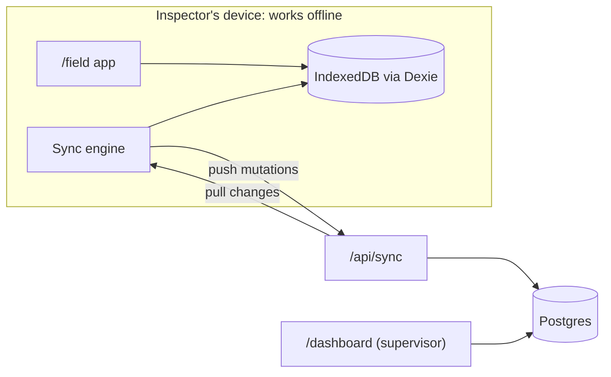

# Field Inspections

**An open-source, offline-first safety inspection app that shows device-to-server sync done
correctly, and explains how.**

**Live demo:** _not deployed yet_ · **Docs:** [Architecture](docs/ARCHITECTURE.md) ·
[Sync](docs/SYNC.md) · [Decisions](docs/DECISIONS.md) · [Testing](docs/TESTING.md)

<!-- GIF placeholder: two browser windows side by side, one forced offline, an inspection
     completed offline, then both reconciling when it reconnects. Recorded from docs/DEMO_SCRIPT.md. -->

> _Demo GIF coming in milestone M5._

## The story

An inspector walks a basement plant room with no signal and completes a scaffold inspection with
photos. One critical item fails. When the inspector is back in coverage, everything syncs
correctly, even if a supervisor changed the same inspection in the meantime.

## Status

Built in six milestones, each reviewed before the next starts.

| Milestone | Scope                                                                       | State       |
| --------- | --------------------------------------------------------------------------- | ----------- |
| M0        | Foundation: tooling, CI, Clerk + `proxy.ts`, Postgres schema, static /field | Done        |
| M1        | Offline field app: Dexie, inspections, answers, critical flags, PWA         | Not started |
| M2        | Sync: outbox, push, pull, HLC, idempotency, rejections                      | Not started |
| M3        | Photos: compression, hashing, upload queue                                  | Not started |
| M4        | Supervisor dashboard: history, conflicts, corrective actions                | Not started |
| M5        | Demo: chaos panel, seed data, accessibility pass, demo script               | Not started |

## Try it in 60 seconds

_Arrives with the live deployment in M5._ The plan: open the demo with `?demo=1`, sign in as the
demo inspector, force the network offline from the chaos panel, complete an inspection with a
failing critical item, then go back online and watch it sync to the supervisor dashboard.

## Features

Planned for the MVP (see [Status](#status) for what exists today):

- **Works with no signal.** The inspector's app is one prerendered page served by a service worker;
  every answer is saved on the device the moment it is given.
- **Sync you can trust.** Mutations queue in an outbox and are pushed idempotently; changes are
  pulled by cursor; a hybrid logical clock orders events even when device clocks are wrong.
- **Answers are events.** Nothing is overwritten. Two devices answering the same item both keep
  their entries, and the conflict is shown, with the full history as an audit trail.
- **Critical failures surface at once** on the device, and become corrective actions on the server
  that only a supervisor can close.
- **Photos follow when bandwidth allows**, compressed and stripped of location metadata on the
  device, uploaded directly to storage.
- **Honest rejections.** If a supervisor cancels an inspection while the inspector is offline, later
  answers are rejected with a reason, kept visible on the device, and exportable.

## Architecture



Three areas with different rules: `/field` (static, offline), `/dashboard` (server-rendered,
online, supervisors only) and `/api/*` (authenticated, idempotent route handlers). Details and the
reasons behind them: [docs/ARCHITECTURE.md](docs/ARCHITECTURE.md).

## Stack

Next.js 16 (App Router, Cache Components) · React 19 · TypeScript (strict) · Tailwind CSS 4 ·
Clerk · Postgres (Neon) + Drizzle ORM · Dexie (M1) · Serwist (M1) · Vercel Blob (M3) · Zod ·
Vitest, fast-check, PGlite, Playwright · GitHub Actions · Vercel.
Where versions differ from the original brief, [docs/DECISIONS.md](docs/DECISIONS.md#9-versions)
says why.

## Local setup

**Prerequisites:** Node 22 (see `.nvmrc`), pnpm 10 (`corepack enable`), a Clerk account (free), and
a Postgres database: a free Neon project, or any local Postgres 15+.

```bash
pnpm install
```

```bash
cp .env.example .env.local
```

Fill in `.env.local`; every variable is described in [`.env.example`](.env.example).

### Clerk

1. Create an application in the [Clerk Dashboard](https://dashboard.clerk.com) with **email**
   sign-in, and copy its API keys into `.env.local`.
2. **Sessions → Customize session token**, add:
   ```json
   { "metadata": "{{user.public_metadata}}" }
   ```
   The server reads the role from this claim. A role sent by the browser is never trusted.

### Test users

Create one inspector and one supervisor in **Users → Create user**. Email addresses containing
`+clerk_test` (for example `inspector+clerk_test@example.com`) are Clerk test addresses: no real
email is sent, and the verification code is always `424242`.

Then set each user's **public metadata**:

```json
{ "role": "inspector" }
```

```json
{ "role": "supervisor" }
```

Put both addresses in `.env.local` as `E2E_INSPECTOR_EMAIL` and `E2E_SUPERVISOR_EMAIL` for the
end-to-end tests. To sign in by hand, use the address and the code `424242`.

### Database

```bash
pnpm db:migrate
```

applies the committed migrations in `server/db/migrations` to `DATABASE_URL`. After changing
`server/db/schema.ts`, run `pnpm db:generate` and commit the new migration; CI fails if they
drift apart. Seed data (`pnpm db:seed`) arrives in M5.

### Run it

```bash
pnpm dev
```

Open <http://localhost:3000>. `/field` is the inspector's app; `/dashboard` needs the supervisor
role.

## Tests

```bash
pnpm test
```

runs the unit, property and server tests (no database needed; server tests use PGlite).

```bash
pnpm test:e2e
```

builds the app and runs Playwright in Chromium and WebKit (needs Clerk keys; first run
`pnpm exec playwright install chromium webkit`). More in [docs/TESTING.md](docs/TESTING.md).

Other checks: `pnpm lint`, `pnpm typecheck`, `pnpm format:check`, and `pnpm build`, which fails if
`/field` is not fully static.

## Continuous integration

Every pull request and every push to `main` runs lint, formatting, type-check, the migration drift
check, unit/property/server tests with coverage, a production build with the static-route check,
and then Playwright. Playwright traces are uploaded when a test fails.

The end-to-end job needs these **repository secrets**: `NEXT_PUBLIC_CLERK_PUBLISHABLE_KEY`,
`CLERK_SECRET_KEY`, `E2E_INSPECTOR_EMAIL`, `E2E_SUPERVISOR_EMAIL`. Pull requests from forks run
every check except end-to-end.

## Known limitations

- **No background sync on iOS.** iOS has no Background Sync, so sync runs only while the app is
  open. The app always shows how many items are waiting.
- **Install the app on iOS.** Safari can clear storage for sites not added to the home screen after
  7 days without use.
- **Sign in once online.** Clerk's browser script loads from Clerk's servers, so the first sign-in
  on a device needs a connection.
- **One tenant, two roles.** No organisations or multi-tenancy, by design.

## Disclaimer

Demo project. The checklists are illustrative and are not a substitute for an inspection by a
competent person or for any legal requirement.

## Licence

[MIT](LICENSE)
