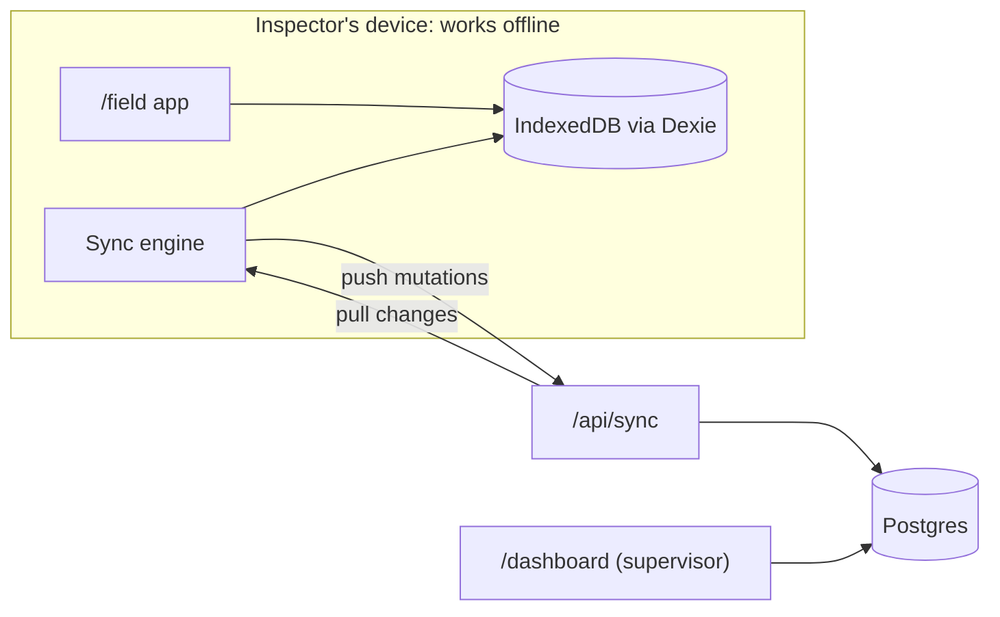

# Field Inspections

**An open-source, offline-first safety inspection app that shows device-to-server sync done
correctly, and explains how.**

**Live demo:** _link added once the production deployment is public_ · **Docs:** [Architecture](docs/ARCHITECTURE.md) ·
[Sync](docs/SYNC.md) · [Decisions](docs/DECISIONS.md) · [Testing](docs/TESTING.md) ·
[Demo script](docs/DEMO_SCRIPT.md)

<!-- GIF placeholder: two browser windows side by side, one forced offline, an inspection
     completed offline, then both reconciling when it reconnects. Recorded from docs/DEMO_SCRIPT.md. -->

> _Demo GIF to be recorded from [docs/DEMO_SCRIPT.md](docs/DEMO_SCRIPT.md)._

## The story

An inspector walks a basement plant room with no signal and completes a scaffold inspection with
photos. One critical item fails. When the inspector is back in coverage, everything syncs
correctly, even if a supervisor changed the same inspection in the meantime.

## Status

Built in six milestones, each reviewed before the next starts.

| Milestone | Scope                                                                       | State |
| --------- | --------------------------------------------------------------------------- | ----- |
| M0        | Foundation: tooling, CI, Clerk + `proxy.ts`, Postgres schema, static /field | Done  |
| M1        | Offline field app: Dexie, inspections, answers, critical flags, PWA         | Done  |
| M2        | Sync: outbox, push, pull, HLC, idempotency, rejections                      | Done  |
| M3        | Photos: compression, hashing, upload queue                                  | Done  |
| M4        | Supervisor dashboard: history, conflicts, corrective actions                | Done  |
| M5        | Demo: chaos panel, seed data, accessibility pass, demo script               | Done  |

## Try it in 60 seconds

The public demo uses two shared test accounts. They are Clerk test addresses: no email is sent,
and the code is always **424242**. Anyone can use them, so data may be reset at any time.

| Role       | Email                               | Code     |
| ---------- | ----------------------------------- | -------- |
| Inspector  | `inspector+clerk_test@example.com`  | `424242` |
| Supervisor | `supervisor+clerk_test@example.com` | `424242` |

1. Open the demo at `/field?demo=1` and sign in as the **inspector**. Wait for **All synced**.
2. Open **Demo controls** and tick **Force offline**. The badge says **Offline**.
3. **Start an inspection**: any site, _Scaffold pre-use inspection_. Answer a few items. Each one
   says **Saved on device**, and the badge counts what is waiting.
4. Go to **Platform and edges** and enter a guardrail height of **820** mm. A red banner appears at
   once: a critical item failed, and the device knows without asking the server.
5. Untick **Force offline**. The queue drains on its own and the badge returns to **All synced**.
6. In another browser (or a private window), open `/dashboard` and sign in as the **supervisor**.
   Your inspection is there, with a new open critical finding at the top. Open it to see each
   answer's full history, device time next to server time.

### The two-device demo

Put two browser profiles side by side. Sign both in as the inspector, start an inspection on one,
and let the other pull it. Force **both** offline, answer the same item differently on each, then
bring both back online. Both devices and the dashboard flag **Conflicting answers** and keep both
entries in the history; the most recent answer by hybrid logical clock is current. Try the same
with **Clock skew** set to +2 h on one device: the order stays correct.

## Features

- **Works with no signal.** The inspector's app is one prerendered page served by a service worker;
  every answer is saved on the device the moment it is given.
- **Sync you can trust.** Mutations queue in an outbox and are pushed idempotently; changes are
  pulled by cursor; a hybrid logical clock orders events even when device clocks are wrong.
- **Answers are events.** Nothing is overwritten. Two devices answering the same item both keep
  their entries, and the conflict is shown, with the full history as an audit trail.
- **Critical failures surface at once** on the device, and become corrective actions on the server
  that only a supervisor can close.
- **Photos follow when bandwidth allows**, compressed and stripped of location metadata on the
  device, uploaded directly to storage.
- **Honest rejections.** If a supervisor cancels an inspection while the inspector is offline, later
  answers are rejected with a reason, kept visible on the device, and exportable.
- **A supervisor dashboard** with open findings first, URL filters, per-item history, conflict
  flags, photos in a lightbox, and the two supervisor actions: cancel an inspection, close a
  corrective action.
- **A chaos panel** (`?demo=1`) to force the device offline, add latency, drop requests and skew the
  clock, with a live view of the outbox and photo queue.

## Architecture



Three areas with different rules: `/field` (static, offline), `/dashboard` (server-rendered,
online, supervisors only) and `/api/*` (authenticated, idempotent route handlers). Details and the
reasons behind them: [docs/ARCHITECTURE.md](docs/ARCHITECTURE.md).

## Stack

Next.js 16 (App Router, Cache Components) · React 19 · TypeScript (strict) · Tailwind CSS 4 ·
Radix UI · Clerk · Postgres (Neon) + Drizzle ORM · Dexie · Serwist · Vercel Blob (private) · Zod ·
Vitest, fast-check, PGlite, Playwright, axe · GitHub Actions · Vercel.
Where versions differ from the original brief, [docs/DECISIONS.md](docs/DECISIONS.md#9-versions)
says why.

## Local setup

**Prerequisites:** Node 22 (see `.nvmrc`), pnpm 10 (`corepack enable`), a Clerk account (free), and
a Postgres database: a free Neon project, or any local Postgres 15+.

```bash
pnpm install
```

```bash
cp .env.example .env.local
```

Fill in `.env.local`; every variable is described in [`.env.example`](.env.example).

### Clerk

1. Create an application in the [Clerk Dashboard](https://dashboard.clerk.com) with **email**
   sign-in, and copy its API keys into `.env.local`.
2. **Sessions → Customize session token**, add:
   ```json
   { "metadata": "{{user.public_metadata}}" }
   ```
   The server reads the role from this claim. A role sent by the browser is never trusted.

### Test users

Create one inspector and one supervisor in **Users → Create user**. Email addresses containing
`+clerk_test` (for example `inspector+clerk_test@example.com`) are Clerk test addresses: no real
email is sent, and the verification code is always `424242`.

Then set each user's **public metadata**:

```json
{ "role": "inspector" }
```

```json
{ "role": "supervisor" }
```

Put both addresses in `.env.local` as `E2E_INSPECTOR_EMAIL` and `E2E_SUPERVISOR_EMAIL` for the
end-to-end tests. To sign in by hand, use the address and the code `424242`.

### Database

```bash
pnpm db:migrate
```

applies the committed migrations in `server/db/migrations` to `DATABASE_URL` (or
`DATABASE_URL_UNPOOLED` when set). After changing
`server/db/schema.ts`, run `pnpm db:generate` and commit the new migration; CI fails if they
drift apart. Then publish the demo checklists and one past inspection (idempotent; published
versions never change). Set `SEED_INSPECTOR_USER_ID` to the demo inspector's Clerk user id so the
seeded inspection also appears on that inspector's devices:

```bash
pnpm db:seed
```

### Run it

```bash
pnpm dev
```

Open <http://localhost:3000>. `/field` is the inspector's app; `/dashboard` needs the supervisor
role.

## Tests

```bash
pnpm test
```

runs the unit, property and server tests (no database needed; server tests use PGlite).

```bash
pnpm test:e2e
```

builds the app and runs Playwright in Chromium and WebKit (needs Clerk keys; first run
`pnpm exec playwright install chromium webkit`). More in [docs/TESTING.md](docs/TESTING.md).

Other checks: `pnpm lint`, `pnpm typecheck`, `pnpm format:check`, and `pnpm build`, which fails if
`/field` is not fully static.

## Continuous integration

Every pull request and every push to `main` runs lint, formatting, type-check, the migration drift
check, unit/property/server tests with coverage, a production build with the static-route check,
and then Playwright. Playwright traces are uploaded when a test fails.

The end-to-end job needs these **repository secrets**: `NEXT_PUBLIC_CLERK_PUBLISHABLE_KEY`,
`CLERK_SECRET_KEY`, `E2E_INSPECTOR_EMAIL`, `E2E_SUPERVISOR_EMAIL`. Pull requests from forks run
every check except end-to-end.

## Deploying to Vercel

1. Import the repository in Vercel (framework: Next.js; `vercel.json` sets the build command).
2. Add **Neon** from the Vercel Marketplace (Storage → Neon, free plan) and connect it to the
   project; it sets `DATABASE_URL` and `DATABASE_URL_UNPOOLED`.
3. Add `NEXT_PUBLIC_CLERK_PUBLISHABLE_KEY`, `CLERK_SECRET_KEY` and `NEXT_PUBLIC_DEMO_MODE` for
   Production, Preview and Development.
4. Every deployment runs `pnpm db:migrate && pnpm build`, so the committed migrations are applied
   before the new code goes live, and every pull request gets a preview deployment.

## Known limitations

- **No background sync on iOS.** iOS has no Background Sync, so sync runs only while the app is
  open. The app always shows how many items are waiting.
- **Install the app on iOS.** Safari can clear storage for sites not added to the home screen after
  7 days without use.
- **Sign in once online.** Clerk's browser script loads from Clerk's servers, so the first sign-in
  on a device needs a connection.
- **One tenant, two roles.** No organisations or multi-tenancy, by design.
- **Shared demo accounts.** The public demo runs on a Clerk development instance with two shared
  test users. New sign-ups get no role and cannot record or view inspections.
- **No "close inspection" action.** The `closed` status exists in the data model (and is honoured
  by sync), but the dashboard only cancels inspections and closes corrective actions, as briefed.
- **Photos are JPEG only**, at most 1600 px on the long side, after compression on the device.

## Disclaimer

Demo project. The checklists are illustrative and are not a substitute for an inspection by a
competent person or for any legal requirement.

## Licence

[MIT](LICENSE)
