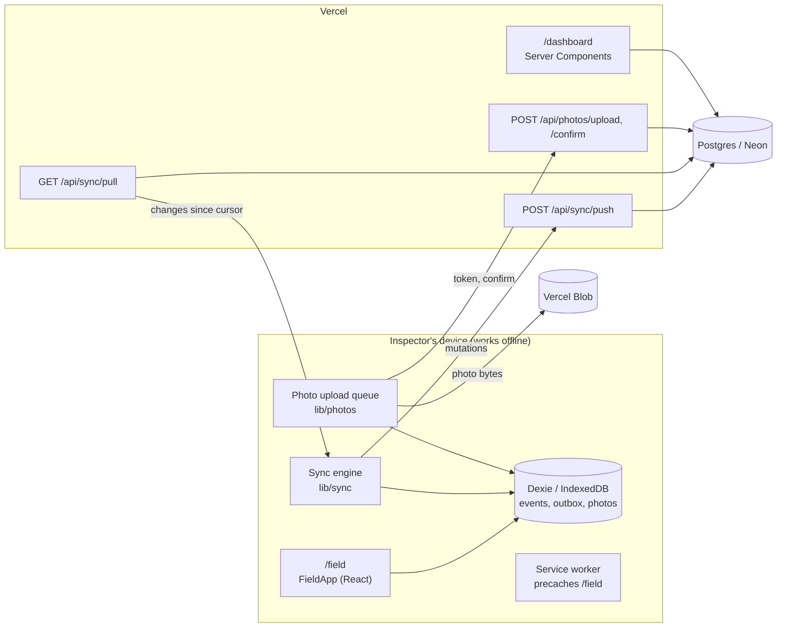

# Architecture

Field Inspections is split into three areas with different rules. The inspector's app must open
and work with no network; the supervisor's dashboard assumes one.

| Area         | Purpose                | Rendering                                                  | Works offline |
| ------------ | ---------------------- | ---------------------------------------------------------- | ------------- |
| `/field`     | Inspector's app        | One statically prerendered page; all data from Dexie       | Yes           |
| `/dashboard` | Supervisor's view      | Server Components and Server Actions, supervisor role only | No            |
| `/api/*`     | Sync and photo uploads | Route handlers, authenticated, idempotent                  | n/a           |



Only the arrows between the device and the server need a connection. Everything inside the device
box works with none.

## Status

| Piece                                 | Milestone | State       |
| ------------------------------------- | --------- | ----------- |
| Static `/field` shell, `ensureStatic` | M0        | Done        |
| Clerk, `proxy.ts`, role checks        | M0        | Done        |
| Postgres schema and first migration   | M0        | Done        |
| Dexie, inspections, answers, Serwist  | M1        | Not started |
| Outbox, push, pull, HLC               | M2        | Not started |
| Photos                                | M3        | Not started |
| Dashboard                             | M4        | Not started |

## Why /field is one static route

An inspection created offline gets its id on the device. The server has never rendered
`/inspections/<that-id>`, so reloading that URL offline would have nothing cached to show. Instead
the whole field app lives on `/field`:

- Views are search params: `/field?view=inspection&id=<uuid>&section=<sectionId>`.
- They change with `window.history.pushState` / `replaceState`. Next.js syncs these with
  `useSearchParams`, and no request leaves the device.
- The page's server component reads no `cookies()`, `headers()`, `auth()` or `searchParams`. It
  renders `<FieldApp />` inside `<Suspense>`; `useSearchParams` makes that subtree render in the
  browser, so the prerendered HTML is identical for every `/field` URL.

**How it is enforced.** `app/field/page.tsx` exports `ensureStatic = 'navigation'`, so `next build`
fails if the route ever needs request-time rendering (see `docs/DECISIONS.md` #10). After the build,
`scripts/check-static-routes.mjs` independently checks the build output: `/field` must be in the
prerender manifest with `compute: "static"`, no revalidation, and a prerendered HTML file. CI runs
both on every pull request.

## Auth boundaries

- `proxy.ts` runs `clerkMiddleware()`. `/dashboard*` requires a signed-in supervisor (others go to
  sign-in or `/forbidden`). `/api/*` requires a signed-in user and answers `401` JSON otherwise.
- `/field` is not matched by the proxy at all, so neither auth nor Clerk's session handshake can
  ever redirect it. The service worker will precache it, and a precached redirect would break the
  offline app. A unit test pins the matcher.
- Every route handler and Server Action calls `auth()` itself and reads the role from the verified
  session claims (`server/auth.ts`). The proxy is the outer fence, not the only one.
- The field app runs from `meta.lastUser` on the device whether or not Clerk's browser script has
  loaded (M1). Only sync needs a live session.

## Code boundaries

| Path          | Runs on        | May import                    | Must not import        |
| ------------- | -------------- | ----------------------------- | ---------------------- |
| `lib/schemas` | Both           | `zod`                         | `server/`, `lib/db.ts` |
| `lib/db.ts`   | Device only    | Dexie, `client-only`          | `server/`              |
| `lib/*` other | Device or both | `lib/schemas`                 | `server/`              |
| `server/`     | Server only    | `server-only`, Drizzle, `lib` | `lib/db.ts`, Dexie     |
| `components/` | Device         | `lib/`                        | `server/`              |

The `server-only` and `client-only` packages make a wrong import fail the build; ESLint
`no-restricted-imports` rules in `eslint.config.mjs` catch it earlier, in the editor.

## Service worker strategy

Planned for M1 (Serwist):

- Precache the build assets and the `/field` page.
- Answer every navigation to `/field`, with any search params, with the cached `/field` page.
- Network-only for `/api/*` and `/dashboard*`; never cache their responses.
- Stale-while-revalidate for Clerk's browser script; the app must work if it fails to load.
- Register from a client component with `updateViaCache: 'none'`. When a new version is waiting,
  show an "Update available" toast; never activate it automatically while an inspection is open.

## Repository layout

```
app/
  field/page.tsx            static shell, renders <FieldApp />
  dashboard/                Server Components (+ Server Actions from M4)
  sign-in/                  Clerk <SignIn />
  forbidden/                shown to signed-in users without the supervisor role
  layout.tsx                ClerkProvider (static), disclaimer footer
proxy.ts                    clerkMiddleware()
components/field/  components/dashboard/  components/ui/
lib/
  auth/roles.ts             role parsing from session claims (shared)
  schemas/                  Zod schemas shared by device and server
server/                     every module imports 'server-only'
  auth.ts                   session user and role checks
  db/schema.ts              Drizzle schema
  db/migrations/            committed drizzle-kit migrations
  db/client.ts              lazy node-postgres pool
scripts/check-static-routes.mjs
tests/  unit/  property/  server/  e2e/
docs/
```
