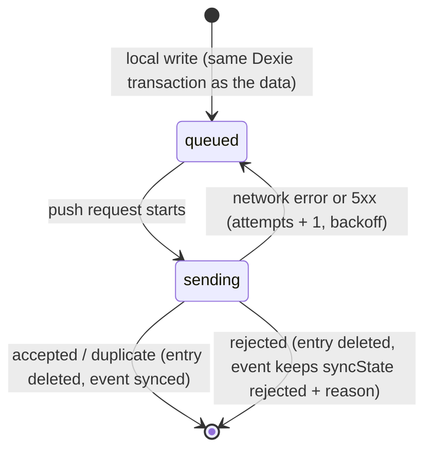

# Sync

> **Status:** implemented (M2). Code: `lib/sync/` on the device, `server/sync/` on the server,
> shared shapes in `lib/schemas/sync.ts`. Proved by the property tests and the device ↔ server
> round trip described in `docs/TESTING.md`.

The device is the source of truth for the inspector's work; the server decides what is accepted.

## Principles

1. **Write to Dexie first, then the network.** Every local write adds an outbox entry in the same
   Dexie transaction as the data it describes.
2. **Every server write is idempotent.** A retried mutation returns its stored result.
3. **Nothing is dropped silently.** An outbox entry is removed only after the server has answered
   for it; a rejected record stays visible on the device with its reason.
4. **Answers are events.** Merging devices is a set union; the current value is a pure function of
   the set.

## Mutations

Each outbox entry is `{ mutationId (UUIDv7), kind, payload, hlc }`.

| Kind                | Payload                                 | Server checks                                                                                                                                  |
| ------------------- | --------------------------------------- | ---------------------------------------------------------------------------------------------------------------------------------------------- |
| `inspection.create` | The `Inspection`                        | Caller is an inspector; the template version exists                                                                                            |
| `answer.record`     | The `AnswerEvent` (without `syncState`) | Inspection exists, belongs to the caller, status is `draft`; the item exists in the locked template version; the value matches the item's kind |
| `inspection.submit` | `{ inspectionId, submittedAtDevice }`   | Inspection belongs to the caller and is `draft`                                                                                                |

## Push: `POST /api/sync/push`

Server: `server/sync/push.ts`. Device: `lib/sync/outbox.ts` and `lib/sync/engine.ts`.

- Body: `{ deviceId, mutations: Mutation[] }`, at most 100 per request, validated with Zod.
- Mutations are processed in order, each inside its own savepoint, and each result is recorded in
  `processed_mutations`. A `mutationId` seen before returns its stored result unchanged.
- Response: `{ results: [{ mutationId, status: 'accepted' | 'duplicate' | 'rejected', reason? }], serverTime }`.
- `rejected` is final: the device marks the record rejected, shows the reason, never retries.
  A network error or 5xx is temporary: the device retries with backoff.
- If the device clock is more than 5 minutes from `serverTime`, the device shows a quiet "device
  clock looks wrong" notice. Ordering stays correct either way (see the clock below).

Details that matter:

- **One transaction per batch.** It takes the `server_seq` advisory lock first; each mutation then
  runs in a savepoint, so a rejection rolls back only that mutation.
- **Duplicates.** A mutation id already in `processed_mutations` is not applied again. If it had
  been accepted the result is `duplicate`; if it had been rejected, the same rejection comes back.
- **The server owns identity.** `createdBy` and `authorId` must equal the session user
  (`not_owner` otherwise), `hasCriticalFailure` is computed from accepted events, and a role in
  the body is meaningless (the strict schema rejects unknown keys).
- **Unexpected errors** (a bug, a lost database connection) abort the whole batch and record
  nothing, so the device retries it; only expected refusals are final.
- **A missing result** (the server never omits one, but the device does not assume it) puts the
  entry back in the queue and the engine backs off instead of looping.

### Rejection reasons

`inspection_not_found`, `inspection_cancelled`, `inspection_closed`, `inspection_submitted`,
`not_owner`, `unknown_template_version`, `unknown_item`, `invalid_payload`, `forbidden`.
Defined once in `lib/schemas/reject-reason.ts`, with the text the device shows.

## Pull: `GET /api/sync/pull?cursor=<n>&limit=500`

- Returns `{ changes: { templates, inspections, answerEvents, correctiveActions }, nextCursor, hasMore }`:
  everything with `server_seq > cursor`.
- An inspector pulls all published templates, their own inspections with their events, and the
  corrective actions on those inspections.
- The device applies each page in one Dexie transaction with `bulkPut` (safe to apply twice) and
  saves `nextCursor` in the same transaction.

A sync cycle is: push everything queued, pull until `hasMore` is false, then run the photo upload
queue.

### Why the cursor needs an advisory lock

`server_seq` comes from one Postgres sequence shared by every synced table and is set on every
insert and update. Sequence values are handed out when a row is written, but rows become visible
only when their transaction commits:

```
T1: nextval → 41 ........................ commit
T2:            nextval → 42 .. commit
Pull:                              reads > 40 → sees 42, cursor = 42   (41 not yet visible)
Pull:                                                 reads > 42 → 41 is never seen
```

To prevent this, every transaction that assigns `server_seq` first takes
`pg_advisory_xact_lock(SERVER_SEQ_LOCK_KEY)`. The lock is held until commit, so the next
transaction can draw its numbers only after the previous one is visible. Pull never skips a row.

**Trade-off.** Writes that assign `server_seq` are serialised. A push holds the lock for one
request's worth of mutations (at most 100), which is milliseconds at demo scale. A high-write
system would instead track a commit-time horizon (for example, only serving rows below the oldest
in-progress transaction via `pg_current_snapshot()`) or use logical replication. Transaction-scoped
advisory locks work behind Neon's transaction-mode pooler, because they never outlive the
transaction.

## Hybrid logical clock

Stored in Dexie `meta` as `(wallMs, counter)`.

- **Local event:** `wallMs = max(stored wallMs, now)`; the counter resets to 0 if `wallMs` moved,
  otherwise it increments.
- **Pull:** remote clocks are merged in the same way, so a device never issues a clock lower than
  one it has seen.
- **Encoding:** a zero-padded string ending in the `deviceId`, so plain string order is clock order.
- The chaos panel's clock skew is added to `now` here.
- Format: `<wallMs, 15 digits>-<counter, 5 digits>-<deviceId>`, e.g.
  `001794430000123-00042-01935c4e-…`. A counter overflow borrows the next millisecond.
- Pull merges only the latest remote clock of each page (`lib/sync/clock.ts`), inside the same
  Dexie transaction that stores the page.

The current value of an item is the event with the highest `(hlc, deviceId)`.

## Conflict rules

| Situation                                             | Rule                                                                                                             | What people see                                                                                           |
| ----------------------------------------------------- | ---------------------------------------------------------------------------------------------------------------- | --------------------------------------------------------------------------------------------------------- |
| Two devices answer the same item                      | Keep both events; the current value is the highest `(hlc, deviceId)`                                             | If the values differ, "conflicting answers" in both apps, with both entries in the history                |
| The template changed while the inspector was offline  | The inspection stays on its locked version; new inspections use the latest                                       | Nothing unusual                                                                                           |
| The supervisor cancelled the inspection while offline | Later `answer.record` and `inspection.submit` are rejected with `inspection_cancelled`                           | A banner on the inspection; rejected answers marked with the reason; data stays on the device, exportable |
| A critical item failed offline                        | Flag it on the device at once; on acceptance the server creates a corrective action, unique on `source_event_id` | The flag appears immediately; the corrective action appears in the dashboard after sync                   |
| A retry sends the same mutation twice                 | Return the stored result                                                                                         | Nothing changes                                                                                           |
| The device clock is wrong                             | The HLC keeps the order correct; the dashboard shows device time and server time together                        | A notice on the device if it is more than 5 minutes off                                                   |

## Outbox state machine



Backoff after a failure: 2 s, 4 s, 8 s… capped at 5 minutes, with jitter.

## When sync runs

- On app start, on the `online` event, and when the page becomes visible.
- 2 seconds after the last local write (debounced).
- Every 60 seconds while visible and online.
- Only one tab syncs at a time: `navigator.locks.request('sync', { ifAvailable: true }, …)`.
- Never through Background Sync APIs: iOS lacks them, and one code path is easier to test.
